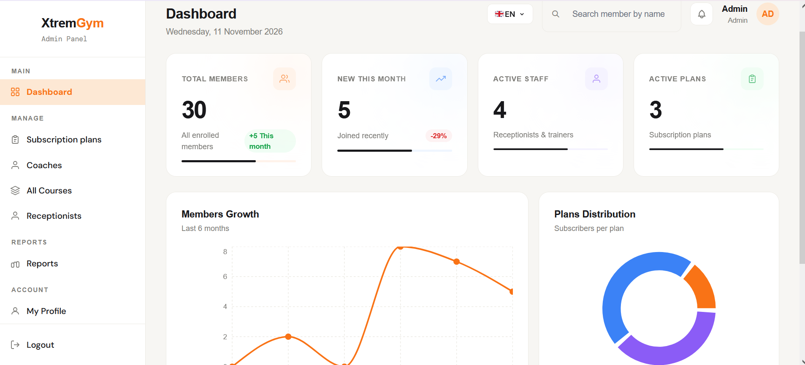
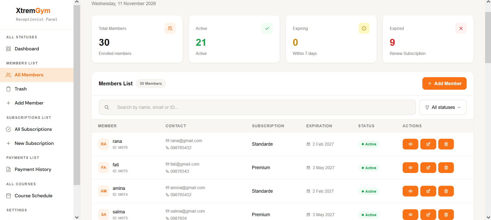
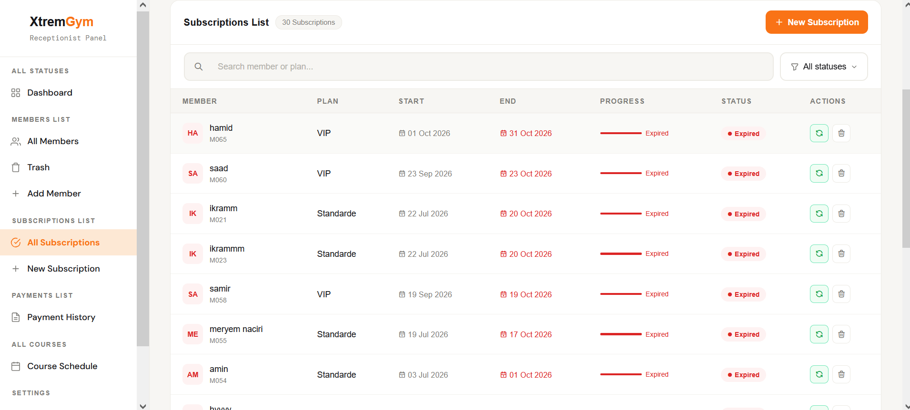
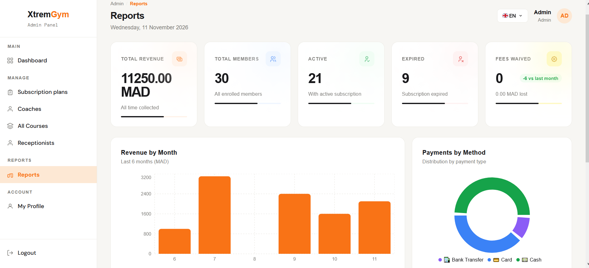
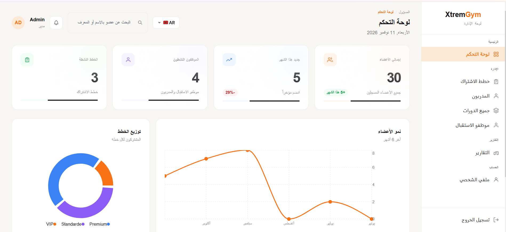
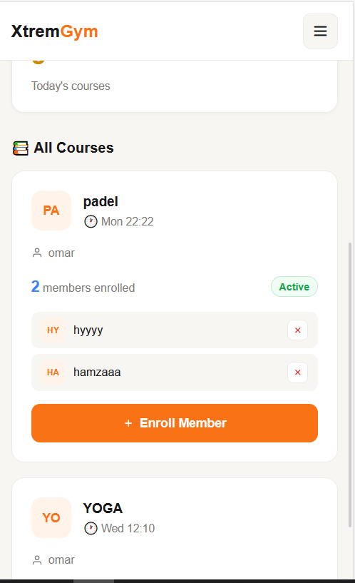

# XtremGym — Gym Management Platform

A full-stack gym management system built for a real gym in Agadir, Morocco.
It replaces paper and spreadsheets with role-based dashboards for the admin, receptionists and coaches.

> Final-year project (PFE), tested with a real gym.

## Features

**Admin**

- Dashboard with live stats and charts (members growth, plans distribution)
- Reports: revenue by month, payments by method, popular plans, waived fees
- Manage subscription plans, coaches, receptionists and courses
- Deactivate staff instead of deleting them (history is preserved)
- Reset a staff member's password

**Receptionist**

- Add, edit, search and filter members (soft delete with Trash / Restore)
- Subscriptions with live status: active, expiring, expired
- New subscription and renewal, with optional registration-fee waiver
- Payment history
- Course enrollment with capacity limits

**Coach**

- Personal dashboard with assigned courses and enrolled members

**General**

- Multilingual: English, French, Arabic (with RTL support)
- Responsive on mobile, tablet and desktop
- Password reset by email
- Login rate limiting and role-based access control

## Tech Stack

- **Backend:** Laravel 12, MySQL
- **Frontend:** React 19 (mounted inside Blade via Vite), Tailwind CSS, Recharts
- **Auth and roles:** Laravel Breeze, Spatie Permission
- **Email:** Resend

## Getting Started

### Requirements

- PHP 8.2+
- Composer
- Node.js 18+
- MySQL

### Installation

```bash
git clone https://github.com/kawtar-bougajgal/gym-management.git
cd gym-management
composer install
npm install
cp .env.example .env
php artisan key:generate
```

Create a MySQL database, then set your credentials in `.env`:

```env
DB_DATABASE=gym_management
DB_USERNAME=root
DB_PASSWORD=
```

Run the migrations and seeders, then start the app:

```bash
php artisan migrate --seed
npm run build
php artisan serve
```

Open http://127.0.0.1:8000

For development with hot reload, run `npm run dev` in a second terminal.

### Email (password reset)

```env
MAIL_MAILER=resend
RESEND_KEY=your_resend_api_key
MAIL_FROM_ADDRESS="onboarding@resend.dev"
```

### Scheduled task

A command marks expired subscriptions. In production, add one cron entry:

```
* * * * * cd /path/to/project && php artisan schedule:run >> /dev/null 2>&1
```

The UI does not depend on it: statuses are computed live from each subscription's end date.

## Screenshots

### Admin Dashboard



### Login


### Members



### Subscriptions



### Reports



### Arabic (RTL)



### Mobile



## What I Learned

- Designing a single source of truth for subscription status
- Soft deletes and keeping financial history intact
- Role-based access with Spatie Permission
- Server-side search and pagination
- Building a fully localized, RTL-ready, responsive UI

## Author

**Kaoutar Bougajgal** — Junior full-stack developer, Agadir, Morocco

[LinkedIn](https://www.linkedin.com/in/kaoutar-bougajgal-9034b82a0/) · [GitHub](https://github.com/kawtar-bougajgal)
